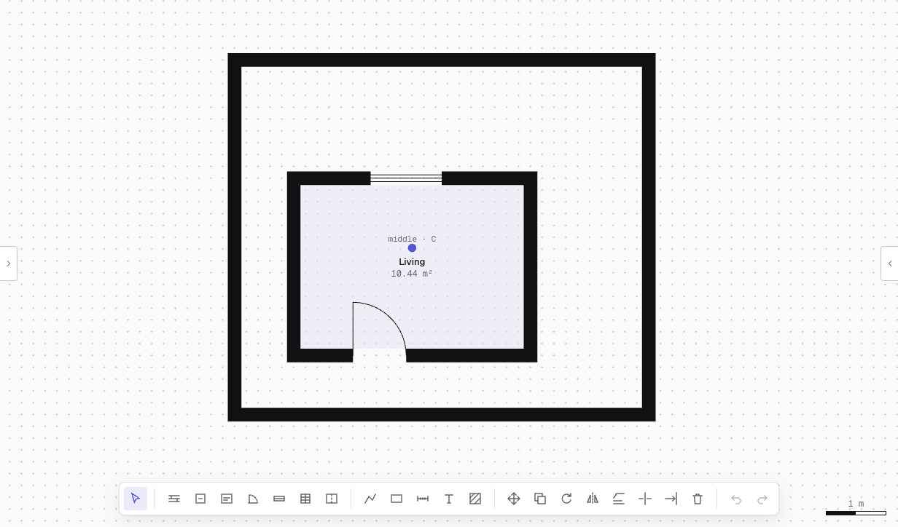
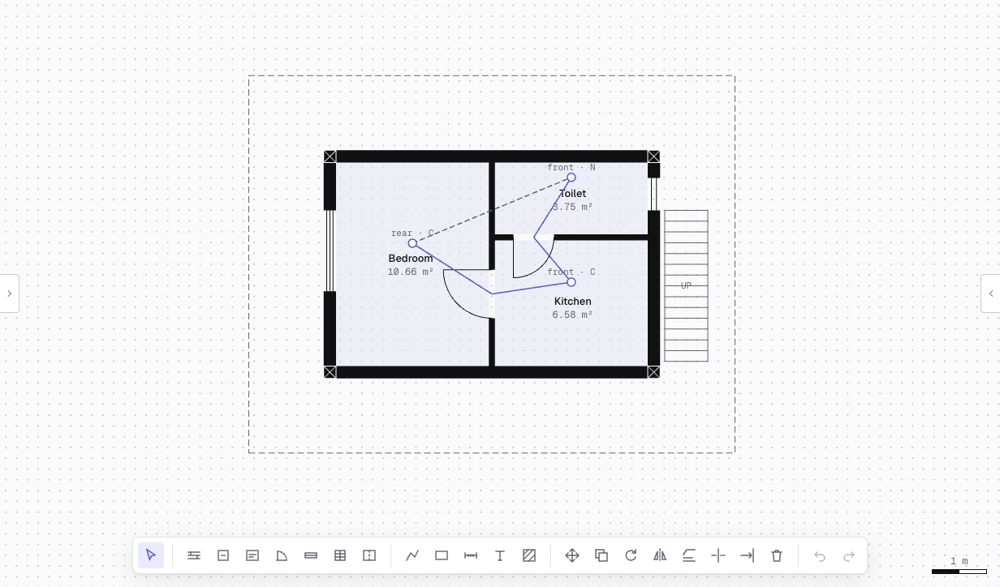
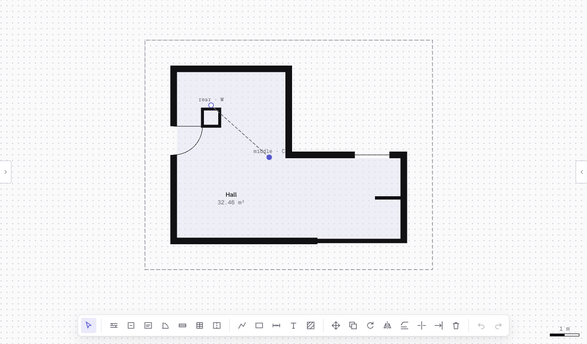
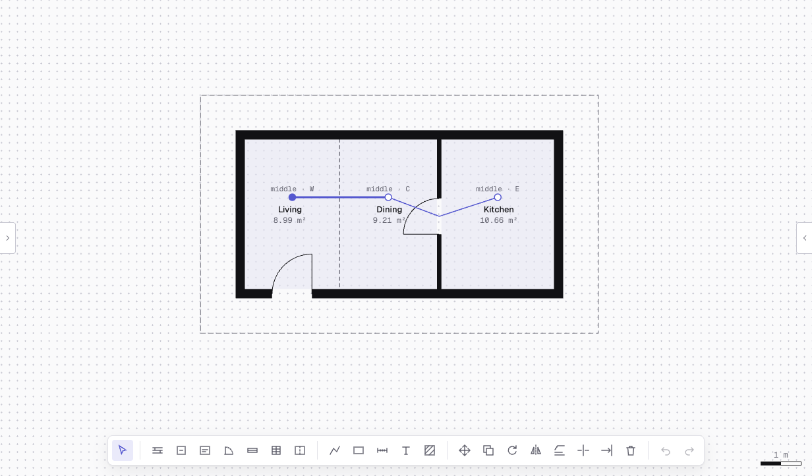
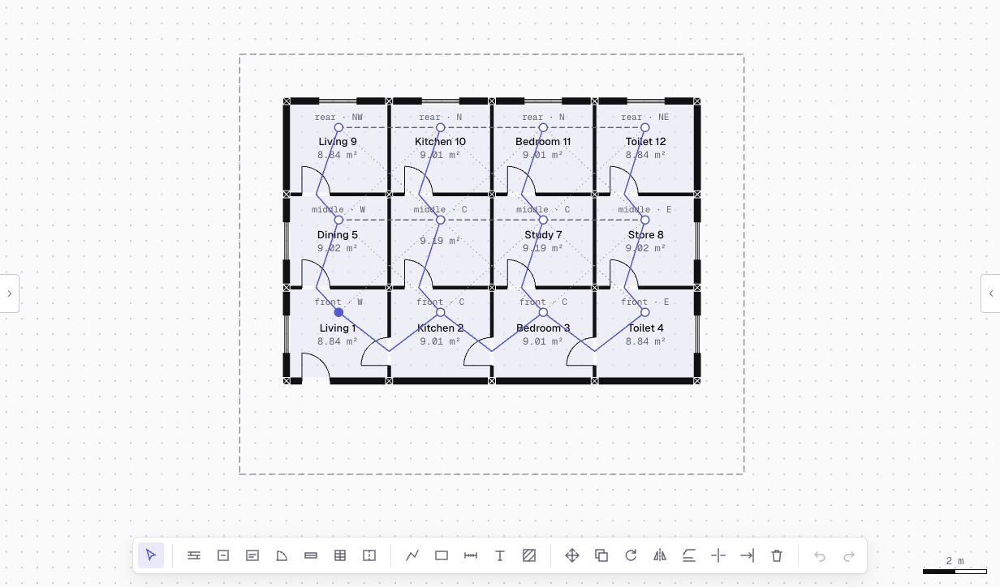

# P3.3 Plan Graph: founder spot-check

Date: 2026-11-07 · Prompt: P3.3 · Decision: D-51 · Status: 🛑 waiting for the founder

## What the Plan Graph is

PlanCraft now reads every plan as a **bubble diagram**: one bubble per room, and a line between two rooms that relate. Nobody draws it: it is worked out from the walls, doors and rooms, and it updates as you edit. Later prompts use it to adapt a plan to a new plot (P6.3), to lay out rooms (P5), and as what the AI model learns (P8).

**To see it in the editor:** left rail → **Layers** → tick **Plan graph (rooms and connections)**. The key appears under the tick box. Click a room: **Properties** lists its zone, Vastu zone, outside walls and what it connects to. ⌘K → "Show the plan graph" works too.

| Line | Means |
|---|---|
| thick solid | **open**: an opening without a door (arch), a room separator (open plan), or two rooms named inside one space |
| thin solid, through the doorway | **door** between the two rooms |
| dashed | **wall only**: they share a wall, with no way through (a window in it doesn't count) |
| dotted | **meet at a corner**: the rooms only touch at a corner |
| filled dot | the room has a **door to the outside** |

Each room's tag reads **depth zone · Vastu zone**, e.g. "front · NE":
- **Depth zone:** front, middle or rear third of the floor, measured from the road side (the plan's facing). Marked "inferred", or "assumed" when the facing was assumed.
- **Vastu zone:** the room's ninth of the plot, north up, the same grid as the Vastu checks. Marked "assumed" (north is assumed to point up).

## The five plans

Your own drawings aren't imported yet, so these are the four sample plans and the 4 × 3 test grid. The same answers are fixed in `engine/graph/plan-graph.test.ts`.

| Plan | What the graph says | Picture |
|---|---|---|
| **A** One room (faces east) | Living, 10.44 m², outside on all four sides, door to the outside. No lines. | `P3.3-plan-graph/a-one-room.png` |
| **B** 1BHK with T-junctions (faces east) | Bedroom **door** Kitchen (D1); Kitchen **door** Toilet (D2); Bedroom and Toilet share a **wall only** (W5). Bedroom is in the **rear** (west) half, Kitchen and Toilet at the **front** (east). No door to the outside in this sample. | `P3.3-plan-graph/b-1bhk.png` |
| **C** L-shaped hall with a duct (faces east) | Hall and Duct share a **wall only** (the duct's four walls). Hall has the door to the outside (west wall). The short wall stub changes nothing. | `P3.3-plan-graph/c-l-hall-duct.png` |
| **D** Open plan with a separator (faces north) | Living **open** to Dining (separator SP1); Dining **door** Kitchen (D1); Living has the door to the outside. All three are "middle": each runs the full depth from the road. | `P3.3-plan-graph/d-open-plan.png` |
| **E** 4 × 3 grid (faces south) | 29 lines: 11 **doors** (each room to the one beside or above it, per the grid's doors), 6 **walls only** (middle and top rows, left to right), 12 **corners** (diagonal neighbours). Rows read front, middle, rear from the road (south). Living 1 has the door to the outside. Master bedroom 6 and Study 7 have no outside wall. | `P3.3-plan-graph/e-grid-4x3.png` |

## 🛑 Questions

1. **Does each graph match what you'd draw?** (the P3.3 check). Say which line or zone is wrong, if any.
2. **Depth zone:** thirds of the floor's depth from the road. Right, or should it be thirds of the **plot**, or "front" only for rooms touching the front wall?
3. **Door to the outside:** today every door in an external wall counts (a back door from the kitchen too). Keep, or mark only the **main entrance** (the road-side door, as the Vastu entrance check picks it)?
4. **Corners:** are "meet at a corner" lines useful to you, or clutter? They can be hidden from the overlay and kept only in the data.
5. Anything an architect expects in a bubble diagram that's missing, e.g. **outside spaces** (sit-out, parking) as bubbles, or the **staircase** linking floors?
